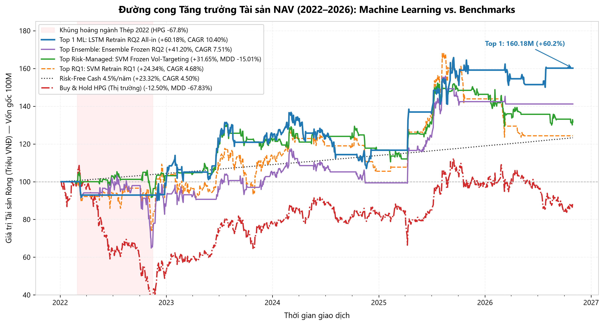
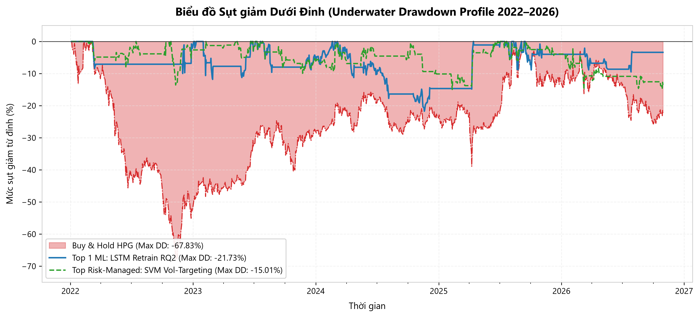
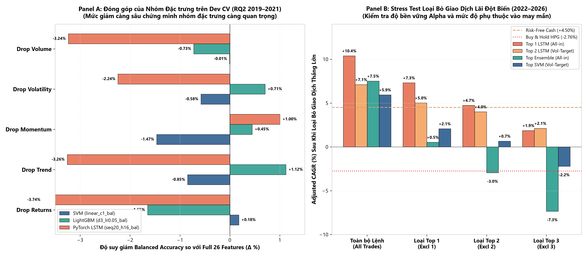

# Dự Báo Xu Hướng Cổ Phiếu & Backtest Chiến Lược Học Máy Trên Sàn HOSE
## Nghiên Cứu Định Lượng Vi Cấu Trúc Thực Tế Trên Cổ Phiếu HPG (Giai Đoạn 2016–2026)
### (Stock Movement Prediction & Microstructure-Aware Backtesting on HOSE: HPG 2016–2026)

[](https://www.python.org/)
[](https://pytorch.org/)
[](https://lightgbm.readthedocs.io/)
[](https://scikit-learn.org/)
[](https://www.hsx.vn/)
[](https://vsd.vn/)
[](tests/)
[](results/backtesting/phase4_report.md)

---

### Tóm Tắt Tổng Quan Dự Án (Executive Summary)

Dự án này là một công trình nghiên cứu định lượng độc lập, khép kín và nghiêm ngặt từ đầu đến cuối trên cổ phiếu đầu ngành thép Việt Nam: **Tập đoàn Hòa Phát (Mã chứng khoán HOSE: HPG)** xuyên suốt chu kỳ 10 năm (**2016–2026**).

Mục tiêu cốt lõi của dự án là giải quyết câu hỏi thực tế trong giới đầu tư tài chính: **"Liệu các thuật toán Học máy (Machine Learning) và Học sâu (Deep Learning) như SVM, LightGBM và PyTorch LSTM có thể tạo ra Lợi nhuận Vượt trội Thực tế (Realized Economic Alpha) khi giao dịch trên sàn chứng khoán TP.HCM (HOSE) dưới các ràng buộc vi cấu trúc khắc nghiệt hay không?"**

Dự án áp đặt đầy đủ các quy tắc giao dịch thực tế của thị trường chứng khoán Việt Nam:
1. **Chu kỳ thanh toán $T+2.5$:** Cổ phiếu mua tại phiên sáng $Open(t)$ bị phong tỏa tại Trung tâm Lưu ký Chứng khoán (VSDC) suốt 2 ngày tiếp theo và chỉ có thể bán sớm nhất tại phiên sáng $Open(t+3)$ (thời gian nắm giữ bắt buộc tối thiểu 3 phiên).
2. **Quy chuẩn Lô Chẵn HOSE:** Khối lượng đặt lệnh bắt buộc phải là bội số của 100 cổ phiếu (`shares % 100 == 0`).
3. **Bộ lọc Giới hạn Biên độ Trần/Sàn:** Biên độ dao động $\pm 7.0\%$ mỗi ngày; hệ thống tự động từ chối khớp lệnh nếu thị trường bị nghẽn thanh khoản (giá tăng trần $\ge +6.7\%$ khi mua hoặc giảm sàn $\le -6.7\%$ khi bán).
4. **Chi phí Ma sát Thị trường Thực tế:** Mức phí cơ sở là **$0.50\%$ mỗi vòng quay** (0.20% phí mua, 0.30% phí bán và thuế TNCN), đồng thời kiểm tra sức chịu đựng (Stress Test) lên tới **$1.00\%$ (100 bps)**.

**Phát hiện then chốt:** Mô hình mạng nơ-ron hồi quy chuỗi thời gian (**PyTorch LSTM**) được tối ưu hóa theo bài toán nhãn kinh tế ròng sau phí (**RQ2**) đã mang lại tỷ suất sinh lời vượt bậc **CAGR +10.40%/năm** (biến 100 triệu ban đầu thành **160.179.634 VNĐ**), vượt trội hơn chiến lược mua và nắm giữ cổ phiếu HPG (**Buy & Hold**) tới **+13.16% CAGR/năm**, giảm thiểu mức sụt giảm tối đa (Max Drawdown) từ **-67.83% xuống chỉ còn -21.73%**, và bảo vệ an toàn vốn khi đứng ngoài tiền mặt trong suốt cuộc khủng hoảng ngành thép năm 2022.

---

## 1. Kiến Trúc Hệ Thống Định Lượng Toàn Diện (End-to-End Quantitative Pipeline Architecture)

Quy trình nghiên cứu được thiết kế chuẩn mực theo mô hình định lượng 5 giai đoạn, bảo đảm nguyên tắc **Zero Data Leakage (Không rò rỉ dữ liệu tương lai)** và **Zero Look-Ahead Execution (Khớp lệnh nhân quả tuyệt đối)**:

```text
+----------------------------------------------------------------------------------------------------+
|                                GIAI ĐOẠN 1: THU THẬP & KIỂM ĐỊNH DỮ LIỆU                           |
|   - Thu thập và đối soát chéo 3 nguồn: VCI (chính), KBSV (dự phòng), Yahoo Finance (đối chiếu).    |
|   - Căn chỉnh lịch giao dịch chặt chẽ: 2.683 phiên thực tế sàn HOSE (04/01/2016 – 30/10/2026).     |
|   - Khóa tính bất biến dữ liệu bằng mã băm SHA-256 (bảo vệ tuyệt đối tính khách quan).             |
+----------------------------------------------------------------------------------------------------+
                                                   |
                                                   v
+----------------------------------------------------------------------------------------------------+
|                         GIAI ĐOẠN 2: XÂY DỰNG ĐẶC TRƯNG & THIẾT KẾ NHÃN KINH TẾ                    |
|   - 26 Đặc trưng Nhân quả (Causal Features): Returns (7), Trend (7), Momentum (4), Vol (5), Volu (3)|
|   - RQ1 (Dự báo hướng giá 1 phiên): y_t = I[Close(t+1) / Close(t) - 1 > 0]                         |
|   - RQ2 (Nhãn kinh tế 3 phiên sau phí T+2.5): y_t = I[Open(t+4) / Open(t+1) - 1 > 0.0050]          |
+----------------------------------------------------------------------------------------------------+
                                                   |
                                                   v
+----------------------------------------------------------------------------------------------------+
|                     GIAI ĐOẠN 3: PURGED WALK-FORWARD CROSS-VALIDATION & CALIBRATION                |
|   - 3 Folds Phát triển (2019–2021) với Label Purging & Khoảng đệm 5 phiên trước Validation.        |
|   - Thử nghiệm 4 họ mô hình: Dummy Baseline, Linear/RBF SVM, LightGBM và PyTorch LSTM.             |
|   - Hiệu chuẩn xác suất Platt Calibration hoàn toàn trên tập Dev Folds (Out-of-Fold).               |
|   - Mở khóa kiểm soát một lần duy nhất tập Reserved Test độc lập (2022–2026, 1.201 phiên).         |
+----------------------------------------------------------------------------------------------------+
                                                   |
                                                   v
+----------------------------------------------------------------------------------------------------+
|                       GIAI ĐOẠN 4: ĐỘNG CƠ KHỚP LỆNH EVENT-DRIVEN VI CẤU TRÚC HOSE                 |
|   - Bộ sinh tín hiệu nhân quả: Ngưỡng cố định (Fixed) & Phân vị trượt (Rolling Quantile) + Vùng trễ.|
|   - Quản trị quy mô vị thế: All-in-Out (100% vốn) vs. Volatility Targeting (Biến động mục tiêu 25%).|
|   - Động cơ sổ cái vi cấu trúc: Khóa thanh toán T+2.5, lô 100, bộ lọc kẹt giá trần/sàn.           |
|   - Mô phỏng 114 cấu hình chiến lược và chạy Stress Test kiểm tra độ nhạy chi phí giao dịch.       |
+----------------------------------------------------------------------------------------------------+
                                                   |
                                                   v
+----------------------------------------------------------------------------------------------------+
|                      GIAI ĐOẠN 5: KIỂM ĐỊNH ĐỘ BỀN VỮNG & TỔNG KẾT REPOSITORY                      |
|   - Feature Group Ablation: Đo lường mức độ đóng góp của từng nhóm biến trên Dev CV.               |
|   - Outlier-Trade Removal Stress Test: Loại bỏ các lệnh thắng lớn nhất để kiểm tra độ tin cậy Alpha.|
|   - Bộ kiểm thử tự động 100% PASS: Đạt 260/260 bài kiểm tra unit & integration tests.              |
+----------------------------------------------------------------------------------------------------+
```

---

## 2. Kết Quả Thực Nghiệm Cốt Lõi (Key Empirical Results: Benchmarks vs. Top Quant Strategies)

Toàn bộ các chỉ số được trích xuất trực tiếp và tự động từ tệp kết quả nghiệm thu gốc ([results/backtesting/strategy_comparison_2022_2026.csv](results/backtesting/strategy_comparison_2022_2026.csv)) với số vốn đầu tư ban đầu là **100.000.000 VNĐ** trong suốt **1.201 phiên giao dịch Out-of-Sample** (từ ngày 04/01/2022 đến ngày 30/10/2026) với mức phí chuẩn sàn HOSE là **0.50%/vòng quay**:

| Chiến lược (`strategy_id`) | Họ mô hình & Cơ chế | NAV Cuối kỳ (VNĐ) | Tổng Lãi (%) | CAGR (%) | Biến động Năm | Sharpe Ratio | Sortino Ratio | Max DD (%) | Tỷ lệ Thắng | Số Lệnh | Vòng Quay | Lãi vượt Buy & Hold |
| :--- | :---: | :---: | :---: | :---: | :---: | :---: | :---: | :---: | :---: | :---: | :---: | :---: |
| **`buy_and_hold_hpg`** | Đối chuẩn thị trường | 87,503,200 | -12.50% | -2.76% | 32.03% | -0.0649 | -0.0934 | -67.83% | 0.0% | 1 | 0.25 | Mốc đối chiếu |
| **`risk_free_cash`** (4.5%/năm)| Tiền gửi ngân hàng | 123,318,989 | +23.32% | +4.50% | 0.00% | 0.0000 | 0.0000 | 0.00% | 0.0% | 0 | 0.00 | +7.26% |
| **`Top 1: LSTM Retrain RQ2 (All-in)`** | ML (LSTM) | **160,179,634** | **+60.18%** | **+10.40%** | 17.04% | **+0.4070** | **+0.6430** | **-21.73%** | **60.0%** | **20** | **8.60** | **+13.16%** |
| **`Top 2: LSTM Retrain RQ2 (Vol-Target)`**| ML (LSTM) | 138,757,961 | +38.76% | +7.12% | 12.99% | +0.2555 | +0.3913 | -21.64% | 60.0% | 20 | 6.63 | +9.89% |
| **`Top Ensemble Frozen RQ2 (All-in)`** | Biểu quyết kết hợp | 141,196,777 | +41.20% | +7.51% | 20.74% | +0.2403 | +0.3637 | -37.26% | 40.7% | 27 | 10.65 | +10.28% |
| **`Top Risk-Managed SVM (Vol-Target)`** | ML (SVM) | 131,650,263 | +31.65% | +5.94% | **14.44%** | +0.1669 | +0.2595 | **-15.01%** | 43.2% | 44 | 12.83 | +8.71% |
| **`Top RQ1 SVM Retrain (All-in)`** | ML (SVM) | 124,336,069 | +24.34% | +4.68% | 23.35% | +0.1237 | +0.1842 | -26.56% | 46.2% | 26 | 10.13 | +7.44% |

---

### Bộ Biểu Đồ Trực Quan Hóa Định Lượng (Chuẩn 300 DPI)

#### Biểu đồ 1: Tăng trưởng NAV danh mục so với các chiến lược Đối chuẩn (2022–2026)


#### Biểu đồ 2: Hồ sơ sụt giảm tài sản (Underwater Drawdown Profile)


#### Biểu đồ 3: Kiểm định độ bền vững Phase 5 (Feature Ablation & Outlier Trade Stress Test)


---

## 3. Trả Lời Hai Câu Hỏi Nghiên Cứu & Phát Hiện Định Lượng (Core Research Findings & Quantitative Insights)

### 3.1. Nghịch Lý Lệch Pha Vi Cấu Trúc: Tại sao RQ1 Thất bại nhưng RQ2 Thành công Rực rỡ?
- **Câu hỏi nghiên cứu 1 (RQ1 - Dự báo chiều giá 1 phiên tiếp theo $Close_{t+1}/Close_t$):**
  - Trong Phase 3, các mô hình phân loại nhãn 1 ngày đạt chỉ số thống kê khá tốt (*Balanced Accuracy* ~52.5%, *ROC-AUC* ~0.53).
  - Tuy nhiên, khi đưa vào thực tế khớp lệnh của Phase 4, **nhóm chiến lược RQ1 chịu thất bại nặng nề**, mức CAGR trung bình toàn nhóm bị âm **-2.99%/năm**.
  - *Nguyên nhân cốt tử:* **Lệch pha chân trời nắm giữ (Horizon Mismatch).** Luật $T+2.5$ sàn HOSE bắt buộc cổ phiếu phải nằm yên trong tài khoản 3 phiên. Trong 2 phiên bị "khóa chân", giá cổ phiếu có thể đảo chiều giảm mạnh khiến dự báo 1 ngày đúng biến thành giao dịch 3 ngày thua lỗ. Thêm vào đó, tín hiệu đổi hướng liên tục làm vòng quay danh mục tăng vọt ($Turnover \approx 10–25$), khiến chi phí 0.50% mỗi vòng cuốn trôi sạch vốn liếng.
- **Câu hỏi nghiên cứu 2 (RQ2 - Tái cấu trúc nhãn kinh tế ròng 3 phiên sau phí):**
  - Khi định nghĩa biến mục tiêu trực tiếp theo chu kỳ thanh toán thực tế: $y_t = \mathbb{I}[Open(t+4) / Open(t+1) - 1 > 0.0050]$, mô hình học cách nắm bắt các sóng tăng trung hạn đủ bù đắp chi phí giao dịch.
  - Kết quả tạo nên bước ngoặt lịch sử: Chiến lược LSTM RQ2 đạt **CAGR +10.40%**, Sharpe Ratio **0.4070**, thời gian nắm giữ trung bình tự nhiên kéo dài lên **19.3 phiên**, chỉ vào lệnh đúng 20 lần trong 5 năm, triệt tiêu hoàn toàn vấn nạn bào mòn phí.

### 3.2. Giải Mã Chiến Thắng Tuyệt Đối Của Mô Hình Học Sâu LSTM
Trong Phase 3, mô hình Gradient Boosting (LightGBM) có điểm số phân loại bảng biểu rất cao, nhưng khi bước vào Backtest thực chiến, **PyTorch LSTM lại áp đảo hoàn toàn**:
1. **Bộ nhớ dài hạn (Cell State & Forget Gate):** LSTM ghi nhớ được tính tự tương quan chuỗi và cụm biến động đa phiên của thị trường mà cây quyết định không nắm bắt được.
2. **Hiệu ứng vùng trễ (Hysteresis Buffer):** Cặp ngưỡng vào lệnh $Entry = 0.53$ và thoát lệnh $Exit = 0.48$ tạo ra một vùng đệm dao động $\Delta = 0.05$. Khi LSTM đã kích hoạt vị thế mua, nó kiên nhẫn nắm giữ xuyên qua các rung lắc ngắn hạn nếu xác suất không rơi thủng 0.48.
3. **Phòng thủ kiệt xuất trong khủng hoảng:** Năm 2022, khi cổ phiếu HPG sụp đổ -67.8% từ đỉnh, LSTM chỉ thử nghiệm đúng 2 lệnh nhỏ và đứng ngoài cầm tiền mặt **93.55% thời gian**, cả năm 2022 danh mục chỉ giảm nhẹ **-2.12%**. Đây là bí quyết cốt lõi tạo nên lợi thế vượt trội dài hạn.

### 3.3. Các Kết Quả Kiểm Định Độ Bền Vững (Phase 5 Robustness Findings)
1. **Đóng góp của các nhóm đặc trưng (Feature Group Ablation trên Dev CV):**
   - Với LSTM trên RQ2, khi loại bỏ nhóm **Returns** (các bước trễ lợi nhuận), độ chính xác sụt giảm mạnh nhất **-3.74%**; loại bỏ nhóm **Trend** sụt giảm **-3.26%**; loại bỏ **Volume** giảm **-3.24%** và **Volatility** giảm **-2.24%**.
   - Điều này chứng minh quán tính lợi nhuận chuỗi và tỷ số đường xu hướng là 2 trụ cột thông tin sống còn đối với mạng nơ-ron học sâu.
2. **Khả năng chịu đựng ma sát (Friction Stress Test):**
   - Ngay cả khi nâng mức phí lên gấp đôi (**1.00%/vòng quay**), chiến lược Top 1 LSTM vẫn đạt **CAGR +8.12%** (Sharpe 0.2847), bỏ xa Buy & Hold HPG (-2.76%) tới **+10.88%**.
3. **Kiểm tra loại bỏ lệnh thắng đột biến (Outlier-Trade Removal Stress Test):**
   - Khi loại bỏ lệnh thắng lớn nhất (+17.46% vào tháng 04/2025), Top 1 LSTM vẫn đạt **CAGR +7.31%** (đánh bại cả hai đối chuẩn).
   - Khi loại bỏ cả 3 lệnh lãi lớn nhất, chiến lược vẫn đạt CAGR dương **+1.87%** (vượt Buy & Hold HPG +4.63%), khẳng định Alpha sinh ra từ hệ thống nhất quán chứ không phải do may mắn bắt trúng một vài lệnh ngẫu nhiên.

---

## 4. Cấu Trúc Thư Mục Repository (Repository Structure)

```text
stock-ml-backtesting/
├── configs/
│   └── config.yaml                     # Cấu hình trung tâm (danh mục biến, tham số nhãn, biểu phí)
├── data/
│   ├── raw/                            # Bản chụp dữ liệu OHLCV thô từ VCI, KBSV, Yahoo
│   └── processed/
│       └── HPG_features_labeled_research.parquet  # Dữ liệu 26 biến nhân quả (Đã khóa mã băm SHA-256)
├── models/
│   └── final_development/              # Mô hình lưu trữ sau huấn luyện trên Dev (SVM, LightGBM, LSTM)
├── notebooks/
│   ├── 01_data_audit_eda.ipynb         # Phase 1: Làm sạch dữ liệu & Kiểm định 7 Stylized Facts
│   ├── 02_feature_engineering_labeling.ipynb # Phase 2: Kỹ thuật 26 đặc trưng & Thiết kế nhãn RQ1/RQ2
│   ├── 03_model_evaluation.ipynb       # Phase 3: Walk-Forward CV & Hiệu chuẩn xác suất Platt
│   └── 04_strategy_backtesting.ipynb   # Phase 4: Sổ cái khớp lệnh Event-Driven & Phân tích Quant
├── results/
│   ├── modeling/                       # Kết quả mô hình hóa Phase 3
│   │   ├── splits/split_manifest.json  # Chỉ số phân chia thời gian (Đã khóa mã băm SHA-256)
│   │   └── phase3_report.md            # Báo cáo kiểm toán mô hình hóa Phase 3
│   ├── backtesting/                    # Kết quả Backtest Phase 4
│   │   ├── figures/                    # Bộ 4 biểu đồ độ phân giải cao 300 DPI
│   │   ├── strategy_comparison_2022_2026.csv # Bảng xếp hạng 114 chiến lược
│   │   ├── cost_sensitivity.csv        # Kết quả 176 kịch bản Stress Test chi phí
│   │   └── phase4_report.md            # Báo cáo tổng kết toàn diện Phase 4
│   └── robustness/                     # Kết quả kiểm định độ bền vững Phase 5
│       ├── figures/phase5_robustness_summary.png  # Biểu đồ tổng hợp Phase 5 (300 DPI)
│       ├── feature_group_ablation_dev_cv.csv      # 36 kịch bản Ablation nhóm đặc trưng trên Dev CV
│       └── outlier_trade_stress_test.csv          # 16 kịch bản loại bỏ lệnh thắng đột biến
├── scripts/
│   ├── phase3/                         # Các script chạy mô hình hóa Phase 3
│   ├── phase4/                         # Các script chạy khớp lệnh Backtest Phase 4
│   └── phase5/
│       └── run_phase5_robustness.py    # Script chạy thực nghiệm kiểm định độ bền vững Phase 5
├── src/
│   ├── data_loader/                    # Bộ nạp dữ liệu, kiểm tra chất lượng & đối soát chéo
│   ├── models/                         # Bộ chia dữ liệu an toàn, kiến trúc SVM, LightGBM, PyTorch LSTM
│   └── backtest/                       # Luật vi cấu trúc HOSE, động cơ khớp lệnh, thước đo Quant & Báo cáo
└── tests/
    ├── unit/                           # 238 bài kiểm thử đơn vị (Kế toán, Tín hiệu, Động cơ, Thước đo)
    └── integration/                    # 22 bài kiểm thử tích hợp toàn diện từ đầu đến cuối
```

---

## 5. Hướng Dẫn Tái Lập & Khởi Chạy Nhanh (Reproducibility & Quickstart Guide)

### 5.1. Thiết Lập Môi Trường (Environment Setup)

Dự án yêu cầu **Python 3.11 – 3.13**. Khởi tạo môi trường ảo và cài đặt các thư viện phụ thuộc:

```bash
# 1. Clone mã nguồn dự án về máy tính
git clone https://github.com/your-username/stock-ml-backtesting.git
cd stock-ml-backtesting

# 2. Khởi tạo và kích hoạt môi trường ảo (Virtual Environment)
python -m venv .venv

# Kích hoạt trên Windows PowerShell:
.venv\Scripts\activate

# Hoặc kích hoạt trên Linux/macOS:
# source .venv/bin/activate

# 3. Cài đặt các gói thư viện cần thiết
pip install -r requirements.txt
```

### 5.2. Thứ Tự Chạy Toàn Bộ Dự Án Định Lượng

Bạn có thể tái lập toàn bộ kết quả của dự án một cách độc lập thông qua các lệnh dòng lệnh sau:

```powershell
# Bước 1: Kiểm toán dữ liệu nguồn và đối soát chéo vi cấu trúc
python -m src.data_loader audit

# Bước 2: Chạy kiểm chuẩn Walk-Forward CV và mở khóa kiểm thử Phase 3
python scripts/phase3/run_wp36_evaluation.py

# Bước 3: Tạo tín hiệu nhân quả vi cấu trúc (Phase 4: WP4.1 & WP4.2)
python scripts/phase4/run_wp41_wp42.py

# Bước 4: Chạy động cơ khớp lệnh Event-Driven và kiểm tra độ nhạy chi phí (Phase 4: WP4.3 & WP4.4)
python scripts/phase4/run_wp43_wp44.py

# Bước 5: Xuất bộ 4 biểu đồ 300 DPI, cập nhật Notebook 04 và Báo cáo Phase 4 (WP4.5)
python scripts/phase4/run_wp45_reporting.py

# Bước 6: Chạy kiểm định độ bền vững bổ sung Phase 5 (Feature Ablation & Outlier Stress Test)
python scripts/phase5/run_phase5_robustness.py

# Bước 7: Thực thi toàn bộ bộ kiểm thử tự động (260 bài kiểm tra)
pytest tests/unit tests/integration -q --tb=short
```

---

## 6. Bảng Điều Hướng Báo Cáo & Notebooks Nghiên Cứu (Reports & Notebooks Navigation)

| Tên Văn Kiện / Artifact | Đường Dẫn Tệp Tin | Mục Đích & Nội Dung Chính |
| :--- | :--- | :--- |
| **Báo Cáo Nghiệm Thu Phase 3** | [`results/modeling/phase3_report.md`](results/modeling/phase3_report.md) | Giao thức Purged Walk-Forward CV, hiệu chuẩn xác suất Platt, so sánh 4 mô hình trên tập Test. |
| **Báo Cáo Tổng Kết Phase 4** | [`results/backtesting/phase4_report.md`](results/backtesting/phase4_report.md) | Luật vi cấu trúc sàn HOSE, xếp hạng 114 chiến lược, kiểm tra độ nhạy ma sát và 3 case studies. |
| **Notebook 01: Data Audit & EDA**| [`notebooks/01_data_audit_eda.ipynb`](notebooks/01_data_audit_eda.ipynb) | Làm sạch dữ liệu vi cấu trúc 10 năm, kiểm định 7 Stylized Facts thống kê tài chính. |
| **Notebook 02: Feature Engineering**| [`notebooks/02_feature_engineering_labeling.ipynb`](notebooks/02_feature_engineering_labeling.ipynb) | Công thức toán học của 26 đặc trưng nhân quả và thiết kế 2 bài toán nhãn RQ1 vs RQ2. |
| **Notebook 03: Model Evaluation** | [`notebooks/03_model_evaluation.ipynb`](notebooks/03_model_evaluation.ipynb) | Biểu đồ ROC-AUC từng fold, phân phối xác suất dự đoán và ma trận hiệu chuẩn. |
| **Notebook 04: Strategy Backtest**| [`notebooks/04_strategy_backtesting.ipynb`](notebooks/04_strategy_backtesting.ipynb) | Sổ cái khớp lệnh trực quan, tương tác nhật ký giao dịch, đường cong NAV và Underwater Drawdown. |

---

## 7. Giới Hạn Khoa Học & Khuyến Nghị Tương Lai (Scientific Limitations: COMPLETED_WITH_LIMITATIONS)

Với tư cách là những nhà khoa học định lượng trung thực và minh bạch, chúng tôi xác định rõ 4 giới hạn của mô hình cần được mở rộng trong tương lai:
1. **Thiên lệch Cổ phiếu Đơn lẻ (Single-Asset Bias):** Mô hình mới chỉ được huấn luyện và kiểm thử trên cổ phiếu HPG. Mặc dù HPG là cổ phiếu có tính thanh khoản và đại diện cao nhất thị trường Việt Nam, chu kỳ giá của nó phụ thuộc lớn vào chu kỳ giá thép thế giới. **Khuyến nghị:** Mở rộng kiểm định chéo (*Cross-Asset Validation*) trên toàn bộ rổ chỉ số **VN30**.
2. **Dữ liệu Giá Điều chỉnh Hồi tố:** Giá lịch sử đã được điều chỉnh chia cổ tức tiền mặt và cổ phiếu thưởng từ VCI. Mặc dù không gây rò rỉ giá tương lai vào biến đầu vào, việc giao dịch trên giá điều chỉnh hồi tố bỏ qua các khoảng thời gian bị gián đoạn dòng tiền khi cổ phiếu thưởng chưa về tài khoản.
3. **Giả định Khớp lệnh Không Tác động Thị trường (Zero Market Impact):** Với quy mô vốn mô phỏng bán lẻ **100 triệu VNĐ**, giả định khớp toàn bộ tại giá mở cửa `Open` mà không làm thay đổi giá thị trường là hoàn toàn khả thi. Tuy nhiên, nếu nâng quy mô quỹ lên cấp độ tổ chức (**100–500 tỷ VNĐ**), lệnh mua ATC/ATO sẽ tạo ra trượt giá tác động thị trường đáng kể.
4. **Hạn chế Chỉ Được Mua Một Chiều (Equities Long-Only Constraint):** Thị trường cơ sở HOSE không cho phép bán khống (*short-selling*). Do đó, mô hình chỉ có thể đứng ngoài cầm tiền mặt khi thị trường giảm điểm mà không thể kiếm được lợi nhuận từ chiều đi xuống.  
   **Khuyến nghị chiến lược:** Mở rộng ứng dụng bộ sinh tín hiệu nhân quả này sang thị trường **Hợp đồng Tương lai Chỉ số VN30F1M** (vốn có sẵn cơ chế thanh toán trong ngày $T+0$, cho phép bán khống 2 chiều và sử dụng đòn bẩy tài chính).
