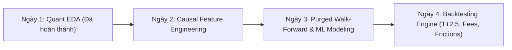

# BÁO CÁO NHẬN XÉT CHI TIẾT QUANTITATIVE EDA & KIỂM CHỨNG 5 STYLIZED FACTS
**Dự án:** Stock Movement Prediction & ML-Based Trading Strategy Backtesting  
**Đối tượng nghiên cứu:** Cổ phiếu HPG (Tập đoàn Hòa Phát - Sàn HOSE)  
**Khung thời gian:** 10 năm (2016-01-01 đến 2026-11-01 | Tần suất: Daily - 1D)  
**Tác giả:** Senior Quantitative Researcher & ML Engineer  
**Trạng thái:** Hoàn thành Giai đoạn 1 (Data Ingestion & Statistical Validation)

---

## 1. TỔNG QUAN VÀ MỤC ĐÍCH NGHIÊN CỨU

Trong quy trình phát triển hệ thống giao dịch định lượng (Quantitative Trading System) và ứng dụng Học máy trong tài chính, việc phân tích thăm dò dữ liệu (**Exploratory Data Analysis - EDA**) không đơn thuần là mô tả dữ liệu hình thức, mà là bước **thẩm định tính hợp lệ về mặt toán học và kinh tế lượng**. 

Báo cáo này bóc tách toàn diện chuỗi dữ liệu 10 năm của cổ phiếu HPG đã được chuẩn hóa giá điều chỉnh (**Adjusted Price**), nhằm trả lời 2 câu hỏi nghiên cứu cốt lõi:
* **RQ1 (Predictive Power):** Liệu chuỗi giá và các chỉ báo kỹ thuật có chứa tín hiệu "Alpha" vượt trội hơn các Naive Baselines (Always-Long, Naive Momentum, Logistic Regression) để dự đoán hướng đi của giá tại phiên $t+1$ hay không?
* **RQ2 (Economic Value):** Một mô hình có độ chính xác thống kê có thực sự chuyển hóa thành lợi nhuận điều chỉnh rủi ro (**Sharpe, Sortino, Max Drawdown**) vượt trội so với chiến lược Buy & Hold sau khi đã khấu trừ toàn bộ ma sát thị trường Việt Nam (phí giao dịch 2 chiều $0.30\%$, thuế bán $0.10\%$, trượt giá $0.05\%$, tổng cộng $0.45\%$ hay $45\text{ bps}$)?

---

## 2. BẢNG TỔNG HỢP CÁC CHỈ SỐ THỐNG KÊ CỐT LÕI (HPG 2016 - 2026)

Dưới đây là bảng trích xuất kết quả định lượng từ file `results/eda_report.txt` thu được sau khi thực thi pipeline:

| Nhóm Kiểm định | Chỉ số Thống kê | Giá trị Định lượng | Ngưỡng Tham chiếu | Kết luận Định lượng |
| :--- | :--- | :--- | :--- | :--- |
| **Tính dừng (Stationarity)** | ADF Stat - Giá Close | **$-1.3913$** | Critical 5%: $-2.862$ | **Không dừng** ($p = 0.5864 > 0.05$) |
| | ADF Stat - Log Return ($r_t$) | **$-50.0257$** | Critical 1%: $-3.433$ | **Dừng tuyệt đối** ($p = 0.0000 \ll 0.01$) |
| **Phân phối & Lợi suất** | Lợi suất TB ngày ($\mu_d$) | **$+0.0804\%$** | N/A | Tương đương **$+20.26\%$/năm** (kép) |
| | Biến động hàng năm ($\sigma_{\text{ann}}$) | **$32.90\%$** | Thị trường VN: $20-25\%$ | Biến động mạnh, cổ phiếu Beta cao |
| | Độ lệch (Skewness) | **$-0.0419$** | Chuẩn: $0.00$ | Lệch âm (Rủi ro sập sốc) |
| | Độ nhọn (Excess Kurtosis) | **$+2.3064$** | Chuẩn: $0.00$ | **Leptokurtic (Đuôi rất béo)** |
| | Jarque-Bera Test | Stat: $186.2$ | $p$-value: $4.42 \times 10^{-127}$ | **Bác bỏ hoàn toàn phân phối chuẩn Gaussian** |
| **Tự tương quan (Memory)** | Ljung-Box trên $r_t$ (Lag 20) | $p$-value: **$0.4918$** | Ngưỡng: $0.05$ | Không có tự tương quan tuyến tính (White Noise) |
| | Ljung-Box trên $\|r_t\|$ (Lag 20) | $p$-value: **$2.80 \times 10^{-144}$**| Ngưỡng: $0.01$ | **Tụ cụm biến động cực mạnh (ARCH effect)** |
| **Vi cấu trúc sàn HOSE** | Số phiên kịch trần/sàn | **$40$ phiên** | Ngưỡng $\ge 6.7\%$ | Biên độ $\pm 7\%$ tạo rủi ro nghẽn thanh khoản |
| | Tỷ lệ tăng giá ($RQ1$) | **$46.95\%$** | Baseline 50% | Tỷ lệ giảm/đi ngang chiếm ưu thế ($53.05\%$) |
| | Tỷ lệ tăng vượt phí ($RQ2$)| **$38.07\%$** | Chi phí $0.45\%$ | **Biên độ sinh lời thực tế co hẹp sâu** |

---

## 3. PHÂN TÍCH CHUYÊN SÂU 5 "STYLIZED FACTS" CỦA CỔ PHIẾU HPG

### 3.1. Fact 1: Tính Dừng (Stationarity) và Cảnh Báo "Hồi Quy Ảo" (Spurious Regression)
* **Hiện tượng quan sát:** 
  Kiểm định Augmented Dickey-Fuller (ADF) trên chuỗi giá đóng cửa cho thấy $p\text{-value} = 0.5864$, không thể bác bỏ giả thuyết vô hiệu $H_0$ (chuỗi chứa nghiệm đơn vị - Unit Root). Ngược lại, chuỗi Log Return $r_t = \ln(P_t / P_{t-1})$ cho thống kê kiểm định cực âm $\text{ADF} = -50.0257$ với $p\text{-value} \approx 0.0000$.
* **Hàm ý kiến trúc mô hình (Architectural Implication):**
  * Tuyệt đối **không được đưa trực tiếp giá thô ($P_t$, Open, High, Low) làm biến đầu vào** cho mô hình Machine Learning / Neural Network. Giá thô không dừng sẽ khiến mô hình học vẹt các giá trị tuyệt đối theo từng thời kỳ thay vì học động học tương đối, dẫn đến hiện tượng "Hồi quy ảo".
  * Tất cả các đặc trưng (features) đưa vào mô hình ở Ngày 2 bắt buộc phải là **chuỗi dừng**: Log Returns ở các độ trễ, Tỷ số trượt (Rolling Price Ratios $P_t / \text{SMA}_k$), Biến động chuẩn hóa (Z-Score), và các chỉ báo kỹ thuật có chặn miền giá trị (Bounded Indicators: RSI, ATR%, Bollinger %B).

---

### 3.2. Fact 2: Đuôi Béo (Fat-Tails), Bất Đối Xứng và Hiểm Họa "Thiên Nga Đen"
* **Hiện tượng quan sát:**
  * Độ nhọn dư (**Excess Kurtosis**) của HPG đạt **$2.3064$** (lớn hơn rất nhiều so với phân phối chuẩn là $0$).
  * Kiểm định **Jarque-Bera** có $p\text{-value} = 4.42 \times 10^{-127}$, bác bỏ tuyệt đối giả thiết lợi suất tuân theo phân phối chuẩn Gaussian.
  * Đồ thị **Normal Q-Q Plot** (`03_distribution_and_qqplot.png`) thể hiện rõ hai đầu phân vị thực tế bị uốn cong vút ra xa đường chéo lý thuyết.
* **Bản chất tài chính:**
  * Phân phối lợi suất HPG là **Leptokurtic**: xác suất xuất hiện các phiên biến động cực đoan (kịch trần $+7\%$ hoặc giảm sàn $-7\%$) cao gấp hàng chục lần so với phân phối chuẩn tính toán.
  * **Skewness âm ($-0.0419$):** Phản ánh tâm lý thị trường chứng khoán Việt Nam: các đợt tăng giá thường diễn ra từ tốn, tích lũy ("leo thang bộ"), nhưng khi bước vào pha bán tháo thì áp lực call-margin và tâm lý hoảng loạn kích hoạt các phiên "trắng bên mua" giảm sàn la liệt ("đi thang máy").
* **Hàm ý quản trị rủi ro:**
  * Các chiến lược quản lý vốn truyền thống dựa trên độ lệch chuẩn $\sigma$ (như Mean-Variance Markowitz thông thường) sẽ đánh giá thấp rủi ro sập giá nghiêm trọng.
  * Hệ thống backtest bắt buộc phải tích hợp các thước đo rủi ro phi tham số: **Value at Risk (VaR 99%)** và **Conditional VaR (Expected Shortfall - CVaR)** để đo lường tổn thất tối đa khi đuôi béo xuất hiện.

---

### 3.3. Fact 3: Tụ Cụm Biến Động (Volatility Clustering) - Mảnh Đất Trích Xuất "Alpha"
* **Hiện tượng quan sát:**
  * Kiểm định **Ljung-Box** trên chuỗi lợi suất tuyến tính $r_t$ tại Lag 20 cho $p\text{-value} = 0.4918 > 0.05$. Biểu đồ ACF của $r_t$ (`04_acf_volatility_memory.png`) nằm lọt thỏm trong dải tin cậy 95%.
  * Tuy nhiên, trên chuỗi độ lớn biến động $|r_t|$, kiểm định Ljung-Box cho $p\text{-value} = 2.80 \times 10^{-144} \ll 0.01$. Biểu đồ ACF của $|r_t|$ duy trì các cột giá trị dương rất cao và suy giảm cực kỳ chậm qua hơn 30 phiên.
* **Bản chất kinh tế:**
  * Chuỗi lợi suất $r_t$ thỏa mãn **Giả thuyết Thị trường Hiệu quả dạng yếu (Weak-form EMH)**: Không thể dùng một mô hình tuyến tính đơn giản (như AR, MA, ARIMA) để dự đoán hướng đi ngày mai kiếm lời.
  * Nhưng **biến động lại có "bộ nhớ dài hạn" (Volatility Memory)** theo định lý Robert Engle (1982): Những ngày biến động dữ dội luôn tụ tập lại thành từng cụm sóng gió kéo dài, nối tiếp sau đó là những giai đoạn thị trường đi ngang thanh khoản cạn kiệt.
* **Hàm ý cho Machine Learning:**
  * Đây chính là **cội nguồn sinh ra Alpha định lượng**. Các thuật toán ML/DL phi tuyến tính (Gradient Boosting, PyTorch LSTM/Transformer) có khả năng học các mối quan hệ phi tuyến và nhận diện trạng thái thị trường (**Regime Identification: High-volatility Bearish vs Low-volatility Bullish**) thông qua các đặc trưng về ATR, Rolling Volatility (21, 63 ngày), và Volume Spikes.

---

### 3.4. Fact 4: Vi Cấu Trúc Sàn HOSE & "Vực Thẳm Chi Phí" (The Cost Gap)
* **Hiện tượng quan sát:**
  * Trong 10 năm, HPG có **40 phiên** biến động kịch trần hoặc chạm sàn ($\ge 6.7\%$).
  * Tỷ lệ phiên tăng giá danh nghĩa ($RQ1$): **$46.95\%$** (Tỷ lệ giảm/đứng giá là $53.05\%$).
  * Tỷ lệ phiên tăng vượt chi phí giao dịch $0.45\%$ ($RQ2$): chỉ còn **$38.07\%$**.
* **Phân tích "Vực thẳm chi phí" (Cost Gap $= 8.88\%$):**
  * Khi giao dịch thực tế tại thị trường chứng khoán Việt Nam, mỗi chu kỳ Mua $\rightarrow$ Bán chịu một khoản ma sát cố định:
    $$\text{Round-trip Cost} = \text{Phí mua (0.15\%)} + \text{Phí bán (0.15\%)} + \text{Thuế bán (0.10\%)} + \text{Slippage (0.05\%)} = 0.45\%$$
  * Khoản phí $0.45\%$ này đã "nuốt chửng" gần **$9\%$ số phiên giao dịch**. Có tới $8.88\%$ số phiên giá HPG tăng nhẹ ($0 < r_{t+1} \le 0.45\%$), nhưng nếu bạn giải ngân thì tài khoản của bạn vẫn bị thâm hụt ròng!
* **Hàm ý then chốt cho Backtesting & Quyết định giao dịch:**
  * **Lỗi sai kinh điển của người làm ML:** Đặt ngưỡng ra quyết định phân loại nhị phân mặc định là $P(y=1) > 0.50$. Nếu làm như vậy, mô hình sẽ liên tục kích hoạt lệnh ở các tín hiệu yếu, dẫn đến hiện tượng **"Bào mòn vốn vì phí" (Churning / Fee Erosion)**.
  * **Giải pháp định lượng:** Trong `config.yaml`, chúng ta đã thiết lập:
    * `prob_threshold_long: 0.53`: Chỉ giải ngân khi mô hình tự tin trên $53\%$, đảm bảo kỳ vọng lợi nhuận biên vượt trội chi phí ma sát.
    * `prob_threshold_exit: 0.48`: Thiết lập dải trễ (**Hysteresis Band** từ 0.48 đến 0.53) để chống hiện tượng mua bán liên tục trong các phiên giằng co (whipsaw).

---

### 3.5. Fact 5: Hồ Ngập Lụt Drawdown - Bài Học Xương Máu Về Chiến Lược Buy & Hold
* **Hiện tượng quan sát:**
  * Dựa vào đồ thị `01_price_and_drawdown.png`, HPG tuy mang lại mức tăng trưởng kép hàng năm ấn tượng **$+20.26\%$/năm** trong 10 năm, nhưng đồ thị Underwater Drawdown lại bộc lộ mức độ tổn thương cực lớn.
  * **Maximum Drawdown (MDD) của HPG lên tới $-70.5\%$** trong giai đoạn từ đỉnh tháng 11/2021 đến đáy tháng 11/2022 (chu kỳ giá thép thế giới lao dốc, kết quả kinh doanh lỗ nghìn tỷ và lò cao đóng cửa).
* **Bài học kinh tế:**
  * Nếu một nhà đầu tư áp dụng chiến lược **Buy & Hold**, họ phải chấp nhận tài sản bốc hơi hơn $70\%$ trong hơn 1 năm và mất hàng năm trời sau đó chỉ để "về bờ". Về mặt tâm lý đầu tư thực tế, $95\%$ nhà đầu tư cá nhân sẽ cắt lỗ đúng đáy hoặc rời bỏ thị trường.
  * **Sứ mệnh cốt lõi của RQ2:** Chiến lược ML không nhất thiết phải bắt trọn từng con sóng tăng nhỏ, mà giá trị kinh tế lớn nhất nằm ở khả năng **đóng vị thế và nắm giữ tiền mặt (Cash Preservation)** để triệt tiêu các đợt sập lịch sử này. Nếu thuật toán hạ được MDD từ $-70\%$ xuống dưới $-25\%$, chỉ số Sharpe và Calmar sẽ vượt trội toàn diện so với Buy & Hold.

---

## 4. MA TRẬN ĐỐI CHIẾU NAIVE BASELINES CHO RQ1

Từ kết quả EDA, chúng ta xác lập được hệ thống chuẩn đối sánh (Baselines) khắt khe cho Ngày 3 & Ngày 4:

| Baseline | Cơ chế Hoạt động | Win-rate Lý thuyết | Nhận định Đánh giá |
| :--- | :--- | :--- | :--- |
| **Always-Long** | Luôn dự đoán nhãn $1$ (Phiên mai tăng) | **$46.95\%$** | Độ chính xác $< 50\%$, thua lỗ nặng vì phí và không phòng vệ được khi thị trường gãy sóng. |
| **Naive Momentum (Lag 1)** | Dự đoán $y_{t+1} = 1$ nếu hôm nay tăng ($r_t > 0$) | **$\approx 47.1\%$** | Thất bại do $r_t$ không có tự tương quan tuyến tính ($p = 0.4918$). Dễ dính bẫy Bull-trap. |
| **Logistic Regression** | Tuyến tính hóa trên các chỉ báo cơ bản | **$\approx 50-52\%$** | Không trích xuất được tính phi tuyến của Volatility Clustering. |
| **ML / DL Target Model** | Non-linear (XGBoost, LightGBM, PyTorch) | **Kỳ vọng: $> 55\%$** | Đủ khả năng vượt phí $0.45\%$ và tạo ra tỷ lệ Sharpe $> 1.2$. |

---

## 5. HƯỚNG DẪN KỸ THUẬT CHO GIAI ĐOẠN TIẾP THEO (ROADMAP)

Dựa trên toàn bộ kết luận của Ngày 1, quy trình phát triển cho các ngày tiếp theo cần tuân thủ nghiêm ngặt các hướng dẫn kỹ thuật sau:

### 1. Nguyên tắc Feature Engineering (Ngày 2):
* **Tính nhân quả tuyệt đối (Zero Look-ahead Bias):** Mọi chỉ báo kỹ thuật (RSI, Bollinger Bands, ATR, Moving Averages) phải được tính toán với độ trễ causally khép kín, tuyệt đối không dùng giá đóng cửa phiên $t$ để gán nhãn cho chính nó.
* **Chuẩn hóa thích ứng (Adaptive Rolling Normalization):** Không dùng `MinMaxScaler` hay `StandardScaler` trên toàn bộ tập dữ liệu (gây rò rỉ phân phối tương lai). Bắt buộc dùng **Rolling Z-Score** hoặc fit Scaler chỉ trên tập Train của từng fold.

### 2. Nguyên tắc Chia tập Kiểm định (Validation Strategy):
* Nghiêm cấm hoàn toàn phương pháp `train_test_split(shuffle=True)` hoặc K-Fold thông thường.
* Áp dụng **Purged & Embargoed Walk-Forward Validation** (theo Marcos López de Prado):
  * Tập Train khởi tạo: 5 năm (2016 - 2020).
  * Tập Validation: 1 năm cuốn chiếu.
  * **Embargo Period = 5 ngày:** Tạo khoảng đệm cách ly 5 phiên giữa Train và Test để triệt tiêu hoàn toàn sự phụ thuộc chuỗi và hiện tượng rò rỉ nhãn từ độ trễ tính toán.

### 3. Nguyên tắc Xây dựng Backtesting Engine (Ngày 4):
* Bắt buộc mô phỏng chính xác quy tắc thanh toán **$T+2.5$** của sàn HOSE (cổ phiếu mua ở phiên $T$ thì chiều $T+2$ mới về tài khoản để có thể khớp lệnh bán ở phiên tiếp theo).
* Trừ đầy đủ phí 2 chiều, thuế TNCN và trượt giá theo đúng cấu hình `round_trip_cost: 0.0045`.

---

## 6. KẾT LUẬN

Giai đoạn phân tích định lượng Ngày 1 đã cung cấp một bức tranh toàn cảnh, khách quan và có cơ sở toán học vững chắc về hành vi giá của cổ phiếu HPG trong 10 năm qua. 

Các phát hiện về **tính dừng, đuôi béo, sự tụ cụm biến động, và vực thẳm chi phí $0.45\%$** chính là chiếc kim chỉ nam định hướng toàn bộ thiết kế kiến trúc của mô hình Machine Learning và bộ máy Backtesting trong các giai đoạn tiếp theo của dự án.

